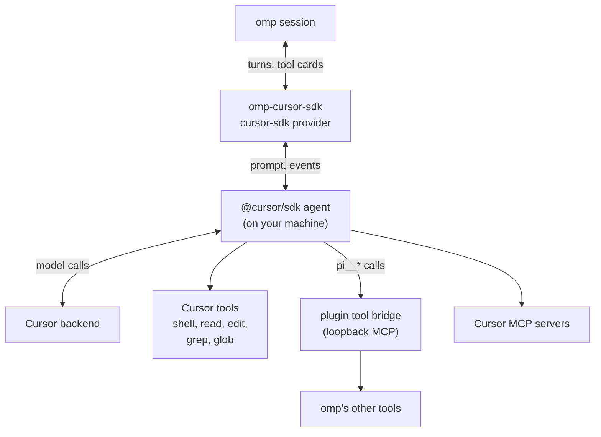
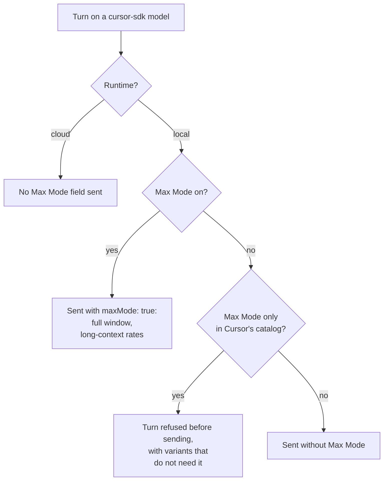

# omp-cursor-sdk

Use Cursor models from [omp](https://github.com/can1357/oh-my-pi). This plugin adds them as the
`cursor-sdk` provider. Each turn runs on your machine through the official
[`@cursor/sdk`](https://cursor.com/docs/sdk/typescript) agent, with a Cursor API key.

omp also ships a built-in `cursor` provider. The two do not share models, keys, or ids.

| | `cursor-sdk` (this plugin) | `cursor` (built into omp) |
|---|---|---|
| Sign-in | Cursor API key (`CURSOR_API_KEY`) | omp `/login` (Cursor OAuth) |
| How a turn runs | `@cursor/sdk` agent on your machine | omp's Cursor agent API |
| Model ids | `grok-4.7@256k`, `grok-4.6@fast` | `grok-4.7-high`, `grok-4.7-high-fast` |

## Install

You need omp 18.3 or newer (tested with 18.3.4). Create a key under Cursor Dashboard → API Keys.

1. Install the plugin from npm.

   ```bash
   omp plugin install omp-cursor-sdk
   ```

2. Save the key. The plugin does not write it for you.

   ```bash
   echo 'CURSOR_API_KEY=crsr_...' >> ~/.omp/.env
   ```

3. Optional: stop the Cursor co-author trailer. Local agents add
   `Co-authored-by: Cursor <cursoragent@cursor.com>` to commits until you patch the SDK. Cloud agents
   always add it. Turns work without the patch, and Max Mode needs none. Run the patch again after
   every install or update.

   ```bash
   cd ~/.omp/plugins/node_modules/omp-cursor-sdk
   node scripts/patch-cursor-sdk.mjs --sdk ~/.omp/plugins/node_modules/@cursor/sdk
   ```

4. Restart omp. The plugin and the key load at startup, and so does the patched SDK if you ran step 3.
5. Confirm the catalog.

   ```bash
   omp models cursor-sdk
   ```

Update with `omp plugin install omp-cursor-sdk --force`. Repeat step 3 if you use the patch, then restart omp.

Use the npm name above. A `github:` URL can leave the plugin half-installed. See
[When something goes wrong](#when-something-goes-wrong) ("The plugin did not install").

From a git checkout, link this repo instead:

```bash
git clone https://github.com/LoneExile/omp-cursor-sdk && cd omp-cursor-sdk
npm install
npm run patch:cursor-sdk   # optional: stops the Cursor co-author trailer
omp plugin link "$PWD"
```

Restart omp after the link. `omp plugin uninstall omp-cursor-sdk` removes the link. It does not delete the checkout.

## Run a model

```bash
omp --model cursor-sdk/composer-2.5
omp --model cursor-sdk/grok-4.7@256k --thinking xhigh
omp --model cursor-sdk/claude-opus-5@300k@slow --thinking max
omp --model cursor-sdk/gpt-5.6-sol@272k --thinking off
```

Copy the id from `omp models cursor-sdk`. The shape is `cursor-sdk/<model>[@<context>][@fast|@slow]`.

- **Context.** A model with context choices exists only as `<model>@<context>`. Use `grok-4.7@256k` or `grok-4.7@500k`. There is no bare `grok-4.7`.
- **Thinking.** Pass the level with `--thinking`. The `thinking` column of `omp models` lists the levels that model accepts. `off` works only when Cursor has an off value.
- **Do not put the level in `--model`.** omp 18.3.4 reads `--model` before plugins load, so `cursor-sdk/grok-4.7@256k:xhigh` is "Model not found". In `modelRoles` the suffix is valid: `default: cursor-sdk/grok-4.7@256k:xhigh`.
- **Fast.** `@fast` and `@slow` pick Cursor's fast lane. Otherwise the model default applies. `/cursor-fast` saves a choice for that model. `--cursor-fast` and `--cursor-no-fast` force it for one run.
- **Window size.** Measured sizes start from a bundled table and update in `~/.omp/agent/cursor-sdk-context-windows.json`. With [Max Mode](#max-mode) on, `@1m` rows measure 1M (`gpt-5.4@1m`: 922k). The `@1m@fast` ids of `gpt-5.4`, `gpt-5.5` and `gpt-5-5` are listed at 272k, a safe floor: Cursor's catalog has no such variant, so they run at 272k with Max Mode off and larger with it on. A completed turn corrects a row.

## How a turn runs



The agent stays on your machine and calls Cursor for the model. Cursor uses its own shell and file tools. omp shows those calls as tool cards. omp's other tools reach Cursor as `pi__*` through a local bridge. [Cloud](#cloud) moves the agent to a Cursor-hosted VM.

## Max Mode

Max Mode is on unless you turn it off, and it applies to the local runtime only. It bills at Cursor's higher long-context rates. `@cursor/sdk` 1.0.40 sends it natively as `ModelSelection.maxMode`, so it needs no patch. Turn it off with `--cursor-no-max-mode`, `PI_CURSOR_MAX_MODE=0`, or `/cursor-max-mode off`.

Cursor Cloud ignores Max Mode. The Cloud Agents API accepts no Max Mode field, so a cloud turn never sends one, and the status line shows no `max:on` there.

With Max Mode off on the local runtime, a variant that Cursor's catalog lists as Max Mode only is refused before any agent is created. That covers every `@1m` variant the catalog lists, `grok-4.7@500k`, and the fast 300k Opus variants. `@cursor/sdk` would run them in Max Mode anyway and bill Max Mode rates. The error lists variants of the same model that do not need Max Mode. A model without catalog variant information is never refused. If you turn Max Mode off while the current model is Max Mode only, `/cursor-max-mode off` warns that its next turn will be refused and names the variants that do not need it.



The status line shows `max:on` while Max Mode is on for the local runtime. `--save-user` writes only `~/.omp/agent/cursor-sdk.json`. Project config cannot set Max Mode. Precedence is `--cursor-no-max-mode`, then `--cursor-max-mode`, then `PI_CURSOR_MAX_MODE`, then the session toggle, then the user file, then on.

## Commit trailer

`@cursor/sdk` 1.0.40 does not read `~/.cursor/cli-config.json` for the commit trailer, and its local executor sets no attribution provider, so local agents add `Co-authored-by: Cursor <cursoragent@cursor.com>` to commits. The optional patch changes that default to off. An explicit attribution value from Cursor still wins. Cloud agents still add the trailer. Restart omp after you patch.

Check the patch without writing files:

```bash
cd ~/.omp/plugins/node_modules/omp-cursor-sdk
node scripts/patch-cursor-sdk.mjs --check --sdk ~/.omp/plugins/node_modules/@cursor/sdk
```

A checkout uses `npm run patch:cursor-sdk` and `npm run check:cursor-sdk-patch`. The patch finds its target by content in `dist/esm`, `dist/cjs` and `dist/bundled`, and fails if a build has no match or several.

## Advisors

An omp advisor on a `cursor-sdk` model gets only the read-only Cursor tools omp granted (`read`, `grep`, `glob`). It does not get Cursor's shell, edits, MCP servers, or subagents. On your machine, a summary that uses omp's summary prompt gets no Cursor tools.

Cloud cannot limit those tools. An advisor request on cloud is refused. Run that advisor on another provider. A cloud summary still has Cursor's full tool set.

## Commands

| Command | What it does |
|---|---|
| `/cursor-refresh-models` | Fetch the catalog now |
| `/cursor-fast` | Toggle fast mode for this model |
| `/cursor-max-mode [on\|off\|toggle] [--save-user]` | Max Mode for this session. Local runtime only. `--save-user` writes the user file only |
| `/cursor-mode agent\|plan` | Cursor conversation mode |
| `/cursor-runtime local\|cloud [--save-user\|--save-project]` | Local agent or Cursor Cloud |
| `/cursor-cloud list \| archive <id> \| delete <id> --yes` | List or remove Cloud agents this plugin created |
| `/cursor-http [on\|off\|toggle]` | HTTP/1.1 transport, for networks that break HTTP/2 |
| `/cursor-refresh-config` | Reload Cursor config into the current agent |
| `/cursor-local-resume-cleanup [--dry-run\|--yes]` | Delete old local SDK agents |
| `/cursor-tools` | Show which tools this turn can call |

One-run flags: `--cursor-fast`, `--cursor-no-fast`, `--cursor-max-mode`, `--cursor-no-max-mode`, `--cursor-mode <agent|plan>`, `--cursor-runtime <local|cloud>`, and the `--cursor-cloud-*` flags.

## Settings

| Name | What to set |
|---|---|
| `CURSOR_API_KEY` | Required. Cursor API key |
| `PI_CURSOR_MAX_MODE` | `0` or `1` to force Max Mode off or on. Local runtime only |
| `PI_CURSOR_RUNTIME` | `local` (default) or `cloud` |
| `PI_CURSOR_SETTING_SOURCES` | Cursor rules the SDK loads. `all` (default), a comma list, or `none` |
| `PI_CURSOR_SDK_EVENT_DEBUG=1` | Write a turn trace under `.debug/cursor-sdk-events/` in the working directory. Delete it after. It can contain prompts and tool output |
| `~/.omp/agent/cursor-sdk.json` | Your saved Cursor settings |
| `<cwd>/.omp/cursor-sdk.json` | Project Cursor settings. This file cannot set Max Mode |

The catalog cache lasts 24 hours (`~/.omp/agent/cursor-sdk-model-list.json`). Set `PI_CURSOR_SDK_MODEL_CACHE_TTL_MS` to change that, or `PI_CURSOR_SDK_DISABLE_MODEL_CACHE=1` to skip the cache.

Full lists: [docs/omp-integration.md](docs/omp-integration.md), [docs/cursor-model-ux-spec.md](docs/cursor-model-ux-spec.md).

## Cloud

Cloud is off until you opt in. `--cursor-runtime cloud` or `PI_CURSOR_RUNTIME=cloud` runs the agent in a Cursor VM against a Git repository. The first cloud turn needs `--cursor-cloud-ack` or `PI_CURSOR_CLOUD_ACK=1`. Uncommitted or unpushed work is rejected unless you allow it. `/cursor-cloud` lists, archives, or deletes the agents this plugin created. [Max Mode](#max-mode) does not apply to Cloud.

## When something goes wrong

- **No `cursor-sdk` rows.** The plugin is not loaded, or it is disabled. Run `omp plugin list`. Without a key you still see a small fallback list, and turns fail until `CURSOR_API_KEY` is set. Restart omp after you add the key.
- **The plugin did not install.** The error names a missing `package.json` under `omp-cursor-sdk` or `github:LoneExile/omp-cursor-sdk`. Not every omp version maps a `github:` spec to the npm name. A failed try can leave `"omp-cursor-sdk": ""` in `~/.omp/plugins/package.json` and a duplicate `bun.lock` key. Reset, install `0.5.0`, and restart omp:

  ```bash
  cd ~/.omp/plugins
  rm -f bun.lock
  bun add omp-cursor-sdk@0.5.0
  ls node_modules/omp-cursor-sdk/package.json node_modules/@cursor/sdk/package.json
  omp plugin list
  ```

  Keep one install. A `github:` spec on top of the npm pin fails with a dependency loop.
- **`Cursor Max Mode is off, but … selects a variant Cursor lists as Max Mode only`.** Max Mode is off on the local runtime, and the model id you chose is a variant Cursor's catalog lists as Max Mode only. The plugin refused the turn before sending it, because the SDK would run it in Max Mode and bill Max Mode rates anyway. Turn Max Mode on (`/cursor-max-mode on`, `--cursor-max-mode`, or `PI_CURSOR_MAX_MODE=1`), or use one of the ids the message lists.
- **`AI Model Not Found` or invalid parameters.** Cursor refused a context variant. On the local runtime, turn Max Mode on if you turned it off. On Cloud, or if that does not help, use the smaller id in the error (`@256k` instead of `grok-4.7@500k`).
- **`unauthenticated` with a valid key.** Cursor's backend sometimes returns this. Retry, or switch `@fast` / `@slow`.
- **Refused by account policy.** Some models need a one-time acknowledgement on the Cursor website. Claude Fable asks you to accept its data-retention policy.
- **Models look old or missing.** The catalog is cached for 24 hours. Run `/cursor-refresh-models`.
- **A shell that cannot start.** The Cursor shell tool's result carries the spawn error: the system error, such as `ENOENT` for a missing working directory or `ENOTDIR` for one that is a file, or `Failed to spawn command`. omp stays up.
- **omp exits a few seconds after a turn.** Open `~/Library/Logs/DiagnosticReports/bun-*.ips`. If it says `EXC_GUARD` / `CLOSE` and guard `0x08fd4dbfade2dead`, that report is from an old process. Update the plugin and restart omp. Current builds keep the Cursor shell subprocess so Bun does not close a SQLite file.
- **You need the exact request.** Set `PI_CURSOR_SDK_EVENT_DEBUG=1`, run one turn, and read `.debug/cursor-sdk-events/**/metadata.json`. Delete that folder after. It can contain prompts and tool output.

## Work on this repo

Node 22.19 or newer.

```bash
npm install
npm test
npm run typecheck:src
omp -e ./src/index.ts --model cursor-sdk/composer-2.5
```

An installed plugin loads next to `omp -e <repo>`. Add `--no-extensions` to use only the checkout. Maintainer rules are in [AGENTS.md](AGENTS.md).

**Release.** Update `CHANGELOG.md`, the `package.json` version, and the `bun add` pin above. Commit, then publish a GitHub Release tagged `v<version>`. [`.github/workflows/release.yml`](.github/workflows/release.yml) publishes that tag to npm. `0.4.0` was published by hand once, to create the npm package.

## Credits and license

Port of [fitchmultz/pi-cursor-sdk](https://github.com/fitchmultz/pi-cursor-sdk) by Mitch Fultz, adapted for omp. MIT licensed. See [LICENSE](LICENSE).
